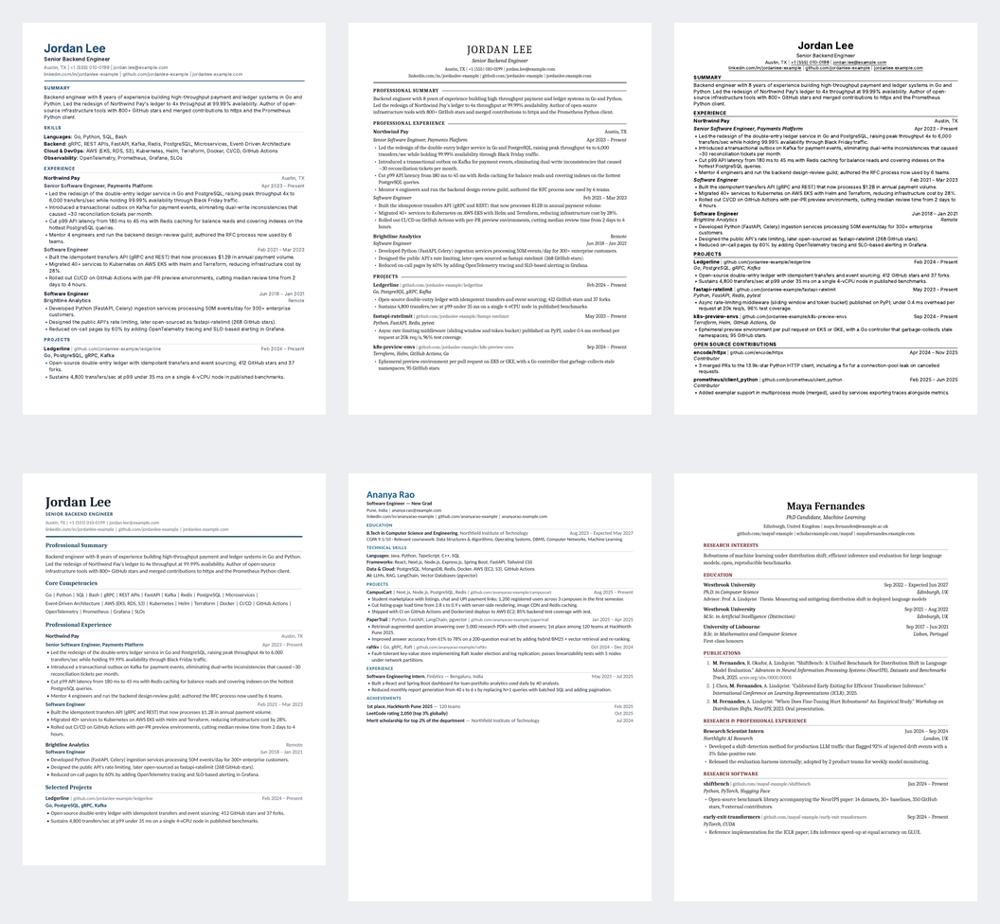
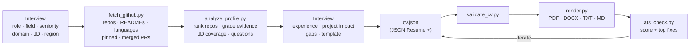
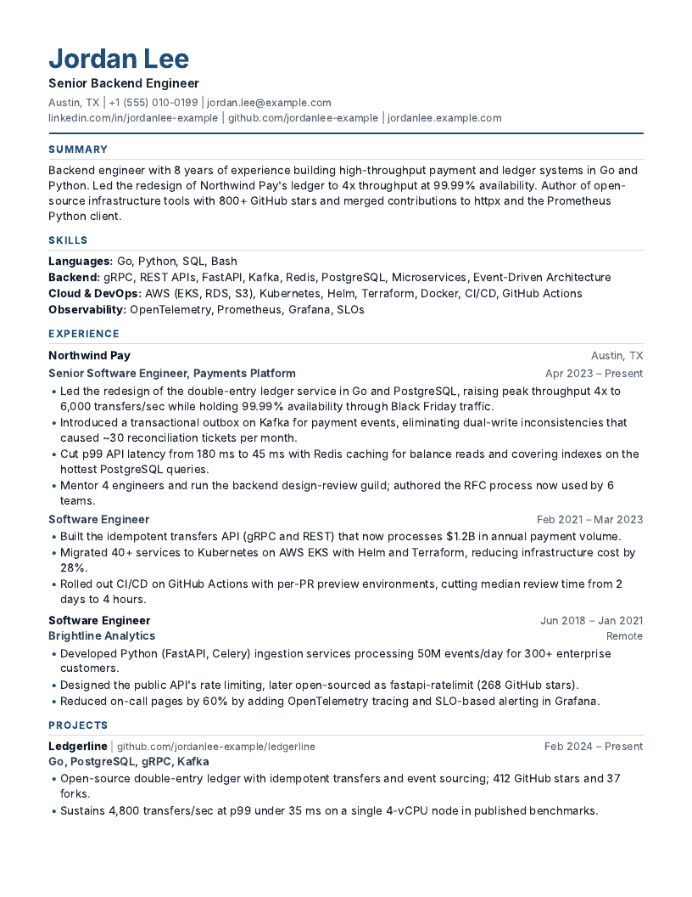
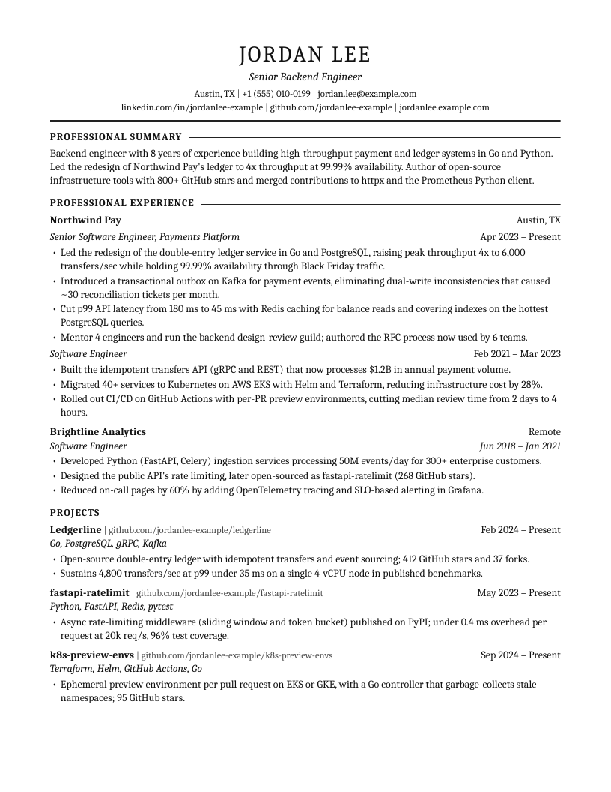
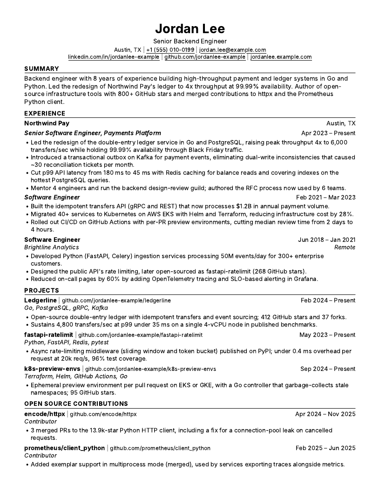
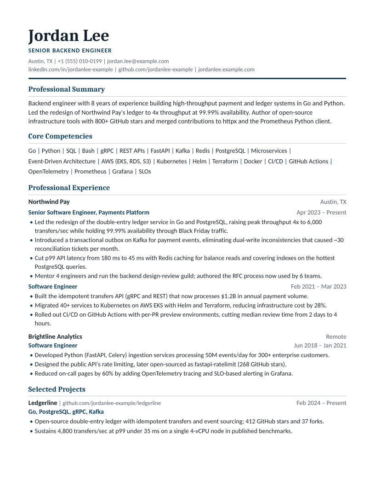
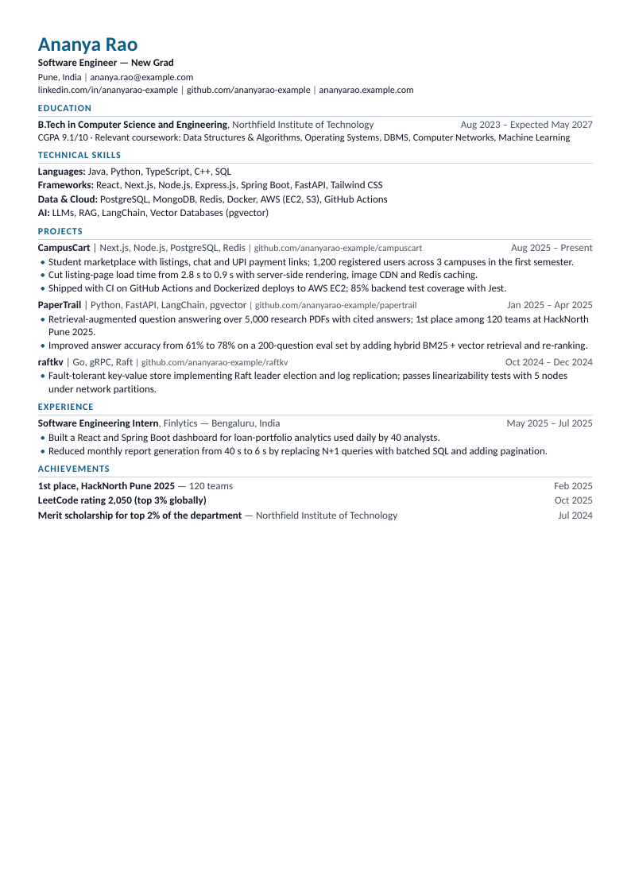
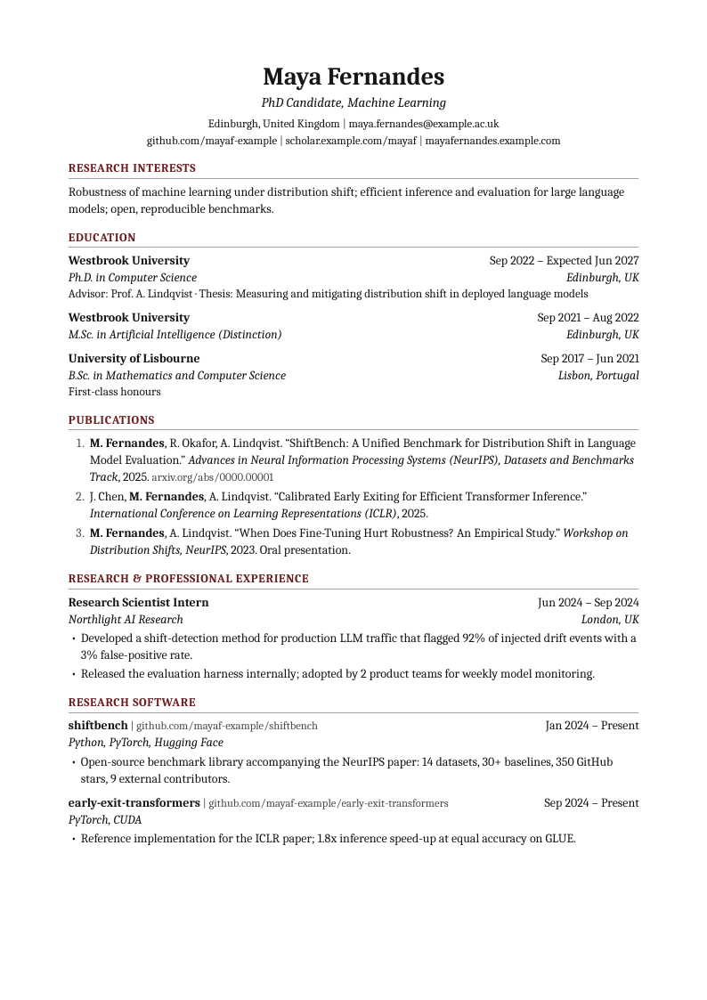

<div align="center">

# github-to-cv

**Turn a GitHub profile into a professional, ATS-optimised CV, built by your AI agent after interviewing you like a recruiter.**

Works with Claude Code · Cursor · GitHub Copilot · Windsurf · Cline · OpenAI Codex · Gemini CLI · any agent that reads `AGENTS.md`

[](LICENSE)


[](https://github.com/loadingscreen78/github-to-cv/actions)



</div>

---

## What it does

Most "GitHub → resume" tools paste your repo list onto a page. **github-to-cv** works like a
technical recruiter and a resume writer together:

- **Interviews you first.** Target role, field, seniority, industry, job description and
  country. Then your experience, the real impact of your projects, and your template choice.
  Questions come in short rounds with sensible defaults.
- **Mines your GitHub for evidence.** It ranks repos by stars, recency, documentation, substance and
  JD relevance. It grades every skill *strong / medium / weak*, finds merged PRs to other projects,
  pulls measurable claims out of READMEs, and spots published packages so it can look up download stats.
- **Never invents anything.** Every claim must trace to GitHub data, your answers, or a
  document you provide. Weak evidence is confirmed with you before it's used.
- **Tailors to the job.** It shows JD keyword coverage and finds *exact-term gaps* (your CV says
  "Terraform", the JD searches for "Infrastructure as Code"). It mirrors the job title,
  reorders your skills and bullets, and leaves out what you don't have.
- **Produces ATS-safe files.** You get PDF, DOCX, TXT (for "paste your resume" boxes) and Markdown from
  six professional templates, or your own design.
- **Scores the result the way an ATS sees it.** It extracts the text from the final PDF/DOCX, then checks
  parsing, contact info, section recognition, keyword coverage, bullet quality and length, and lists
  the top fixes.

---

## Use it with your AI agent

Paste this into any coding agent:

```text
Use https://github.com/loadingscreen78/github-to-cv to build my CV from https://github.com/<your-username>.
Follow its AGENTS.md.
```

The agent clones the repo, reads [`AGENTS.md`](AGENTS.md) → [`SKILL.md`](skills/github-to-cv/SKILL.md),
and starts the interview. Your files appear in `./cv-output/<your-username>/`.

| Tool | Setup (optional, for a native experience) |
|---|---|
| **Claude Code** | `/plugin marketplace add loadingscreen78/github-to-cv` then `/plugin install github-to-cv@github-to-cv`, then run `/github-to-cv:make-cv <github-user> <target role>`. Or copy the skill folder: `cp -r skills/github-to-cv ~/.claude/skills/` |
| **Claude apps (Skills)** | Zip the `skills/github-to-cv` folder and upload it as a custom skill. If the sandbox can't reach `api.github.com`, run `fetch_github.py` locally and attach `github.json`. |
| **Cursor** | Open the repo or just paste the prompt. Rules are in `.cursor/rules/`. |
| **GitHub Copilot** (agent mode) | Reads `.github/copilot-instructions.md`. |
| **Windsurf** | Reads `.windsurf/rules/`. |
| **Cline** | Reads `.clinerules`. |
| **Codex · Jules · Amp · Zed · Aider** | Read `AGENTS.md`. |
| **Gemini CLI** | Reads `GEMINI.md`. |

**Requirements:** Python 3.9+ and `pip install -r requirements.txt` (jinja2, python-docx, pypdf,
pdfminer.six). PDFs are rendered with any installed **Chrome / Edge / Chromium / Brave**. Playwright
and WeasyPrint also work. A GitHub token is optional: set `GITHUB_TOKEN` or run `gh auth login` for 5,000
requests/hour, pinned repos and contribution stats.

---

## The interview

| Round | The agent asks | Why |
|---|---|---|
| **1 · Target** | GitHub username · target role · field · seniority · industry/domain · job description (paste, link or "general") · country/region | Picks keywords, template, length, paper size and personal-data rules |
| **2 · Beyond GitHub** | Confirms contact details prefilled from GitHub · experience (fastest: attach your old resume or LinkedIn PDF) · education · certifications/awards/publications · anything to leave out | GitHub can't know your jobs or degree |
| **3 · Evidence** | Which 3–5 repos to feature · per project: who uses it, numbers, your role, live URL · "The JD wants Kafka. Have you used it?" | Converts repos into quantified, truthful bullets |
| **4 · Format** | Template (recommended one marked, or **bring your own**) · length · formats · accent colour | The look, chosen by you |
| **Review** | Shows the draft, ATS score and missing keywords, then asks what's inaccurate or what to swap | You approve every claim |

The full question bank and branching logic for students, career switchers, researchers, managers and
employment gaps are in [`references/interview.md`](skills/github-to-cv/references/interview.md).

---

## How it works



---

## Templates

| | Template | Best for | Sample |
|---|---|---|---|
|  | **Modern**: sans-serif, navy accent | Most tech roles (default) | [PDF](examples/output/modern.pdf) |
|  | **Classic**: serif, centred, company-first | Finance, consulting, enterprise, formal UK/EU/India | [PDF](examples/output/classic.pdf) |
|  | **Minimal**: dense black one-pager | Big-tech SWE, new grads | [PDF](examples/output/minimal.pdf) |
|  | **Executive**: summary-first, keyword block, promotions grouped | Senior/staff, managers, directors | [PDF](examples/output/executive.pdf) |
|  | **Compact**: education-first, one-line headers | Students, interns, campus placements | [PDF](examples/output/compact.pdf) |
|  | **Academic**: numbered publications, your name in bold | PhD, postdoc, faculty, research | [PDF](examples/output/academic.pdf) |

**Bring your own template.** Give the agent a PDF, DOCX, screenshot or HTML/CSS of a design you like.
It scaffolds a new template (`new_template.py`), recreates the look in an ATS-safe way and checks it.
See [`references/templates.md`](skills/github-to-cv/references/templates.md#bring-your-own-template).
Accent colour, section order, headings, entry layout, fonts and margins can all be changed from `cv.json → meta`.

*All sample people, companies and numbers are fictional.*

---

## What "ATS-optimised" means here (and what we tested)

ATS-friendliness is checked by tests, not assumed:

- **Every template's PDF is parsed in CI** with pdfminer.six, pypdf and poppler. Tests assert that headings are
  recognised, bullets extract as `• text` in reading order, and the sample CV scores ≥ 85.
- **Things that broke parsing in our tests, and are now banned by the test suite:**
  - `font-variant: small-caps` and letter-spacing above ~0.1em make extractors split words
    (`P R O F E S S I O N A L  S U M M A RY`), so the section isn't recognised.
  - Absolutely positioned bullet glyphs get pulled out of reading order by layout-analysis parsers.
  - Native list markers produce no text at all. Our bullets are real `•` characters with a hanging indent.
- **Single column, real text only.** No tables, text boxes, icons, photos, skill bars, or contact
  details in headers/footers. Ligatures are disabled ("fi" can become "f"). Dates are consistent. Headings are standard.
- **DOCX uses real Word headings and list styles.** No tables, text boxes or header/footer parts (checked in tests).
- **Keyword strategy that survives a human reading it.** Exact JD phrasing for skills you really have,
  acronyms spelled out once, the title mirrored in your headline, soft skills shown in bullets, and no stuffing.

Example `ats_check.py` output:

```text
**Score: 91/100 — Excellent**
| ✅ | Required skills from JD | 17.9/22 | 81% of 16 required hard skills appear. |
**Exact-term gaps** (a recruiter's keyword search won't infer these):
- JD says **Infrastructure as Code**; your CV says **Terraform** → write “Infrastructure as Code” explicitly …
- JD says **Message Queues**; your CV says **Kafka** → write “Message Queues” explicitly …
```

ATS scores are heuristics. They catch parsing and keyword problems; content and fit still decide.
See [`references/ats-rules.md`](skills/github-to-cv/references/ats-rules.md) for the rules,
portal notes (Workday, Greenhouse, iCIMS, Taleo, Naukri) and common myths.

---

## Use it without an AI (CLI)

```bash
pip install -r requirements.txt
S=skills/github-to-cv/scripts
python $S/fetch_github.py octocat                                   # → cv-output/octocat/github.json
python $S/analyze_profile.py cv-output/octocat/github.json --jd jd.txt --target "Backend Engineer"
cp cv-output/octocat/cv.draft.json cv-output/octocat/cv.json        # fill in work, education, bullets
python $S/validate_cv.py cv-output/octocat/cv.json
python $S/render.py cv-output/octocat/cv.json -t modern -f pdf,docx,txt --max-pages 1
python $S/ats_check.py cv-output/octocat/Your_Name_Resume.pdf --jd jd.txt --cv cv-output/octocat/cv.json
python $S/render.py --list-templates
```

`cv.json` is [JSON Resume](https://jsonresume.org/schema) compatible, with `openSource`, `customSections` and
`meta` added. See [`references/cv-schema.md`](skills/github-to-cv/references/cv-schema.md).

---

## Repository layout

```
AGENTS.md                      # entry point for every AI agent
CLAUDE.md · GEMINI.md · .cursor/ · .windsurf/ · .clinerules · .github/copilot-instructions.md
.claude-plugin/                # Claude Code plugin + marketplace manifests
commands/make-cv.md            # /make-cv slash command (Claude Code)
skills/github-to-cv/
├── SKILL.md                   # the workflow: interview → evidence → write → render → ATS check
├── references/                # interview · ats-rules · writing-guide · field-playbooks · regional-conventions · cv-schema · templates
├── scripts/                   # fetch_github · analyze_profile · validate_cv · render · ats_check · new_template
│   └── data/                  # skills taxonomy (360+ skills, aliases, implications) · action verbs
└── templates/                 # _base + modern · classic · minimal · executive · academic · compact
examples/                      # fictional CVs, GitHub fixture, JD, rendered PDFs and previews
tests/                         # unit + end-to-end tests (PDF parsing across 3 extractors)
tools/build_previews.py        # regenerate examples/output and previews
```

---

## FAQ

**Is my data sent anywhere?** No. The scripts talk only to `api.github.com`. Everything else runs
locally, and `cv-output/` is git-ignored. Tokens are read from the environment or the `gh` CLI and are
never written to disk. (Your AI agent itself runs under its own provider's terms.)

**My GitHub is thin, or I'm experienced and my best work is private.** That's fine. The interview
collects your experience, and you can attach your existing resume or LinkedIn PDF. GitHub then becomes
supporting evidence, or is left out.

**Students / freshers?** Yes. The Compact template, education-first order, CGPA, coursework,
hackathons and competitive programming are all supported, including Indian campus-placement norms.

**Other languages?** Set `meta.language` and translate the headings with `meta.sectionTitles`.
The agent writes in the language of the job posting.

**Rate-limited?** Unauthenticated GitHub calls are limited to 60/hour. Set `GITHUB_TOKEN` or run
`gh auth login`. Partial data is saved and the agent carries on.

**Does a high ATS score guarantee interviews?** No. It means your CV parses cleanly and contains
the right terms. Truthful, quantified impact gets the interview.

---

## Contributing

Templates, taxonomy entries, field playbooks and regional conventions are especially welcome.
See [CONTRIBUTING.md](CONTRIBUTING.md). Run `python -m unittest discover -s tests` before opening a PR.

## License

[MIT](LICENSE). Sample CVs are fictional; any resemblance to real people is coincidental.
